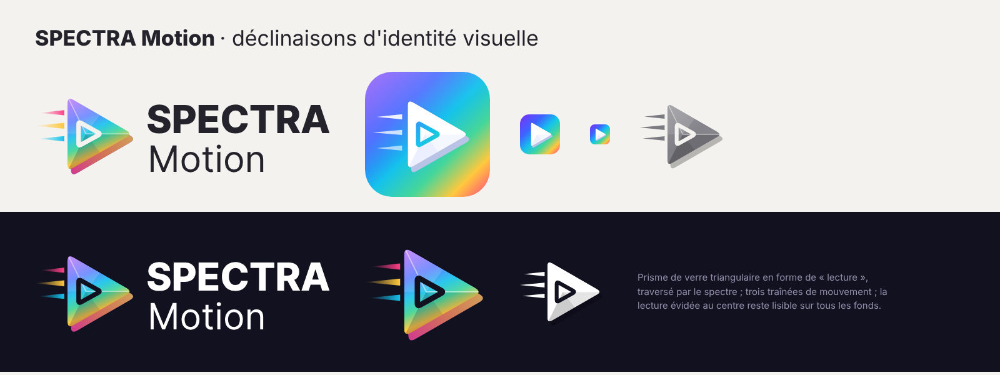

# Spectra Motion · Studio Prism

**Spectra Motion est le studio de création multimédia de la gamme SPECTRA** (Writer, Calc, Slide, Motion) : retouche photo et composition, montage vidéo multipiste, animation par images clés, montage et mixage audio, et création assistée par modèles, dans une seule interface et avec un seul compte Studio Prism.

Un projet est **un seul fichier** que l'on regarde avec cinq studios : un titre animé dans *Motion* est le même calque dans *Vidéo* ; une affiche faite dans *Design* devient une vidéo en changeant de studio. Les médias importés forment une bibliothèque commune à tous les studios du projet.

> Version 0.1.0 · interface en français · site statique (GitHub Pages) · Firebase (Authentication, Firestore, Storage facultatif) · aucun serveur.
> **Démo autonome** (comptes et projets dans le navigateur, sans Firebase) : `dist/spectramotion-demo.html`.
> **En ligne** : pas encore publiée. Comme les autres SPECTRA (`spectrawriter.studio-prism.com`…), l'adresse prévue est `spectramotion.studio-prism.com` : il faut activer GitHub Pages sur ce dépôt, créer l'entrée DNS puis ajouter le fichier `CNAME` (non fait : le sous-domaine n'existe pas encore).



## Ce qui fonctionne (testé)

| Studio | Fonctions réelles |
| --- | --- |
| **Design** | 13 modèles Studio Prism (réseaux sociaux, affiche, miniature YouTube, bannière LinkedIn, carte de vœux, intro vidéo…), 11 formats prédéfinis (16:9, vertical 9:16, carré, 4:5, story, miniature, bannière, A4, 4K…) avec remise à l'échelle du contenu, 12 styles de texte, 13 formes, fonds unis et dégradés, fond transparent, calques (ordre, visibilité, verrouillage), alignement et répartition, repères magnétiques. |
| **Photo** | Import d'images (PNG, JPEG, WebP, GIF, AVIF), 8 réglages (luminosité, contraste, saturation, teinte, température, sépia, flou, vignettage), 10 filtres avec aperçu, recadrage (libre, 1:1, 4:5, 16:9, 9:16, 3:2, et bords au curseur), rotation, miroir, coins arrondis, masques de forme, opacité, modes de fusion, ombre portée, bordure. |
| **Vidéo** | Import de vidéos (MP4, WebM, MOV selon le navigateur), d'images et de sons ; timeline multipiste (pistes visuelles au-dessus, pistes audio en dessous) ; déplacer un clip dans le temps et d'une piste à l'autre ; raccourcir par les bords ; couper à la tête de lecture (S) ; vitesse (× 0,25 à × 4) ; volume, fondus, coupure du son ; effets d'entrée et de sortie (fondu, glissements, zoom, rebond, volet, flou) ; titres et sous-titres ; aperçu synchronisé image + son ; aimantation ; zoom de la timeline. |
| **Motion** | Images clés sur la position, l'échelle, la rotation et l'opacité, avec interpolation et 5 courbes (douce, linéaire, accélération, décélération, maintien) ; propriétés animées dépliées dans la timeline (déplacer une image clé, double-clic : courbe, Alt + clic : supprimer) ; 14 animations prédéfinies (apparition, glisser, rebond, machine à écrire, Ken Burns, battement, flotter, rotation, traversée…) ; textes animés. |
| **Audio** | Pistes audio avec forme d'onde, volume (jusqu'à 200 %), fondus d'entrée et de sortie, vitesse, découpe et déplacement, son des vidéos mixé, **enregistrement d'une voix off** au micro, synchronisation à l'échantillon près avec l'image. |
| **Exports** | Image PNG (fond transparent possible) / JPEG / WebP ; vidéo **WebM** (VP9 ou VP8 + Opus), **MP4** (H.264 + AAC) quand le navigateur sait l'enregistrer, en 480p, 720p, 1080p ou 4K, son mixé, durée inscrite dans le fichier ; son **WAV** 48 kHz stéréo (mixage hors temps réel) ; projet `.spectramotion` ou **paquet `.zip`** (projet + médias) à rouvrir sur un autre appareil. |
| **Compte et cloud** | Compte Studio Prism commun (même projet Firebase `archivision-studioprism` que le site, Writer, Calc, Slide et Nexus) : connexion, inscription, mot de passe oublié, fiche client, code PIN, empreinte / visage, licences par produit (`licenses/{uid}_spectramotion`). Projets enregistrés automatiquement dans Firestore (état affiché, nouvel essai en cas d'échec, jamais « enregistré » avant confirmation), dossiers, partage par email ou par lien (lecture / modification), quotas (10 Mo, 50 Mo avec licence, 1 Go administrateur). |
| **Médias** | Fichiers gardés dans l'appareil (IndexedDB) **et** envoyés dans Firebase Storage quand il est activé : un projet rouvert sur un autre appareil retrouve ses médias. Sans Storage, tout fonctionne sur l'appareil et l'interface l'indique. Un média absent peut être relié à un nouveau fichier. |
| **Interface** | Thème clair ou sombre, annuler / rétablir illimité (120 étapes), copier-coller, raccourcis clavier (touche ?), glisser-déposer de fichiers, panneaux repliables, infobulles, états vides, lecture seule pour les projets partagés en lecture, installation comme application (PWA), adaptation aux petits écrans (priorité à l'ordinateur). |

Tests : 9 tests unitaires du modèle, 41 tests des règles Firestore + Storage sur émulateurs, 37 vérifications de bout en bout en démo et 8 en mode Firebase réel (émulateurs Authentication, Firestore, Storage). Détail dans [`docs/TESTS.md`](docs/TESTS.md).

## Ce qui n'est pas encore fait (à développer)

- **Suppression d'arrière-plan**, masques dessinés à la main, retouche locale (pinceau, tampon) : non disponibles (un modèle d'IA ou une bibliothèque de segmentation serait nécessaire).
- **Réduction du bruit** et effets audio avancés (égaliseur, compresseur, réverbération) : non disponibles ; seuls volume, fondus et vitesse le sont.
- **Transitions entre deux clips** au sens strict (fondu enchaîné automatique) : on obtient le même résultat avec un effet de sortie sur le premier clip et un effet d'entrée sur le second, ou deux clips qui se chevauchent sur deux pistes.
- **Suggestions automatiques de composition** (studio Design) : non disponibles.
- L'export vidéo se fait **en temps réel** (un projet de 30 s demande 30 s, onglet visible). Un encodage image par image (WebCodecs) est la prochaine étape.
- Pas de bibliothèque de médias libres de droits intégrée, ni d'assistant IA pour l'instant (l'IA de la gamme SPECTRA pourra être branchée comme dans Writer, Calc et Slide).
- Les invités d'un **dossier** partagé ouvrent les projets du dossier mais ne téléchargent pas leurs médias depuis Storage (limite des règles Storage : voir `firebase/README.md`) ; partager le projet lui-même résout le cas.

## Architecture

Mêmes conventions que les autres SPECTRA : du JavaScript sans framework, assemblé par `tools/build.py` en une seule page.

```
index.html                 page en ligne (générée : python3 tools/build.py)
dist/spectramotion-demo.html  démo autonome (générée)
src/parts/                 en-tête, structure (intro, compte, accueil, atelier)
src/css/                   charte SPECTRA (base, intro, compte, accueil) + motion.css (l'atelier)
src/js/                    compte Studio Prism (auth.js), cloud, accueil et médias dans Storage (cloud.js), menu du compte (auth-end.js)
src/motion/                l'atelier, un module par responsabilité :
  00-util.js               outils, icônes, bus d'évènements
  10-model.js              modèle de projet (calques, pistes, images clés), assainissement, historique
  15-templates.js          modèles Studio Prism
  20-media.js              bibliothèque de médias (IndexedDB, Storage, décodage du son, formes d'onde)
  30-render.js             moteur de rendu (canvas 2D) : le même pour l'aperçu et les exports
  40-playback.js           lecture : horloge Web Audio, son programmé, vidéos synchronisées
  50-stage.js              scène : sélection, déplacement, redimensionnement, rotation, repères, texte sur place
  55-timeline.js           timeline multipiste et images clés
  60-panels.js             panneau de gauche (ressources par studio)
  62-inspector.js          panneau de droite (propriétés)
  70-io.js                 exports image / vidéo / son / projet, ouverture des fichiers projet
  80-main.js               état de l'atelier, actions, raccourcis, pont avec le cloud
assets/branding/           logo et déclinaisons (SVG + PNG), générés par tools/brand.py
firebase/                  mode d'emploi Firebase, CORS du bucket (les règles sont dans le dépôt Studio-Prism)
tests/                     unitaires (Node), règles (émulateurs), bout en bout (Playwright)
```

**Modèle de projet** (`.spectramotion`, JSON versionné) : `{v, app, title, studio, w, h, fps, dur, bg, media:{id:{kind, name, mime, size, w, h, dur, path, cloud, thumb}}, layers:[{id, t, track, start, dur, x, y, w, h, rot, op, sc, kf, tin, tout, …}]}`. Les fichiers des médias ne sont **jamais** dans Firestore : seulement leurs métadonnées (et une vignette de quelques Ko).

**Moteurs** : canvas 2D (filtres CSS du canvas pour les réglages), Web Audio (mixage, décodage, `OfflineAudioContext` pour le WAV), `MediaRecorder` + `captureStream` pour la vidéo, IndexedDB pour les fichiers, JSZip (chargé à la demande depuis jsDelivr, avec contrôle d'intégrité) pour les paquets. Aucune dépendance payante.

## Installation, lancement, construction

```bash
git clone https://github.com/groupestudioprism/SpectraMotion.git && cd SpectraMotion
python3 tools/build.py                 # → index.html et dist/spectramotion-demo.html
python3 -m http.server 8000            # http://localhost:8000/dist/spectramotion-demo.html (démo, sans Firebase)
                                       # http://localhost:8000/ (vrai compte Studio Prism si localhost est un domaine autorisé)
```

On modifie `src/`, on relance `python3 tools/build.py`, on enregistre sur `main` : GitHub Pages publie en une minute (à activer : *Settings → Pages → Deploy from a branch → main / root*).

Logo : `python3 tools/brand.py` régénère tous les fichiers de `assets/branding/` (Python, fonttools, Playwright).

## Tests

```bash
npm install                            # outils de test uniquement (rien n'est nécessaire pour utiliser l'app)
npm test                               # tests unitaires du modèle (Node ≥ 20)
npm run test:rules                     # télécharge les règles depuis Studio-Prism, puis les teste sur les émulateurs (Java ≥ 11)
python3 tools/build.py && npm run test:e2e   # bout en bout dans Chromium (Python + Playwright + ffmpeg)
npx firebase emulators:exec --only auth,firestore,storage --project archivision-studioprism "python3 tests/e2e/firebase.py"
```

## Firebase : à faire à la main

Rien n'est publié automatiquement. Le mode d'emploi complet, avec les scénarios de vérification, est dans [`firebase/README.md`](firebase/README.md) :

1. **Règles Firestore et Storage** : elles vivent dans leur **source unique**, le dépôt Studio-Prism (`firebase/rules/23-spectra-motion.rules`, assemblé dans `firebase/firestore.rules` ; `storage.rules` à la racine), sur la branche `integration-spectra-motion` tant qu'elle n'est pas fusionnée. Ce dépôt n'en garde pas de copie : `npm run test:rules` les télécharge.
2. **Storage (facultatif)** : l'activer dans la console (un nouveau bucket demande le forfait **Blaze**), publier `storage.rules`, autoriser l'accès de Storage à Firestore, appliquer la configuration CORS `firebase/storage-cors.json`. Sans Storage, les médias restent sur l'appareil.
3. **Catalogue** : créer le produit `spectramotion` (« Spectra Motion », description « Création photo, vidéo, animation et audio ») dans l'administration du site pour attribuer licences et clés.

Tant que les règles ne sont pas publiées, l'app fonctionne quand même : les projets sont enregistrés **sur l'appareil**, rattachés au compte, et partent dans le cloud dès que possible.

La configuration Firebase écrite dans `index.html` est publique par conception ; la sécurité repose sur les règles. **Ne jamais ajouter de clé privée ni de compte de service dans ce dépôt.** Il n'y a pas de fichier `.env` : l'app n'a aucun secret.

## Intégration avec les autres applications

Spectra Motion est ajouté (marqué « Bientôt », sans lien tant que l'adresse n'existe pas) sur l'écran de connexion de Writer, Calc et Slide, dans le registre de Nexus, dans les règles communes et la suppression de compte du site Studio Prism : les modifications sont sur une branche `integration-spectra-motion` de chacun de ces dépôts, à fusionner après vérification.
